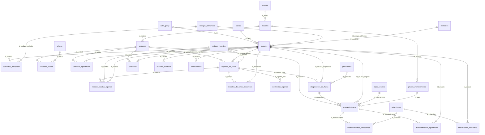

# Modelo de datos

_Generado automáticamente con `python manage.py generar_docs` (2026-11-17). No lo edites a mano._

Convenciones: tablas, columnas y restricciones en español; claves foráneas con prefijo `id_`.

## Diagrama entidad-relación

## Cuentas y trabajadores

### `codigos_telefonicos`

International dialing code of a country (+52, +1, +51...). The rows come from a data migration; the administrator can switch countries on or off. Several countries share a code, so the code is not unique: each country is a row.

| Columna | Tipo | Notas |
|---|---|---|
| `id` | BigAuto | clave primaria; ID |
| `pais` | Char(60) | único; país |
| `iso` | Char(2) | único; ISO |
| `codigo` | Char(4) | código |
| `activo` | Boolean | por defecto: True; activo |

Restricciones:

- `codigo_telefonico_solo_digitos`: restricción CHECK

### `contactos_trabajador`

Another way to reach the SAME worker (a second phone, a second email...), besides the principal phone and email that live in "usuarios". At most MAX_CONTACTS per worker (enforced by the API and the admin; see accounts/contacts.py).

| Columna | Tipo | Notas |
|---|---|---|
| `id` | BigAuto | clave primaria; ID |
| `id_usuario` | FK → usuarios | al borrar: CASCADE; trabajador |
| `tipo` | Char(10) | tipo |
| `id_codigo_telefonico` | FK → codigos_telefonicos | acepta nulo; al borrar: PROTECT; código telefónico |
| `valor` | Char(254) | valor |
| `etiqueta` | Char(40) | etiqueta |
| `nombre_contacto` | Char(150) | nombre de la persona |
| `orden` | PositiveSmallInteger | por defecto: 0; orden |

Restricciones:

- `contacto_codigo_solo_telefonos`: restricción CHECK

### `sexos`

Catalog of sexes (Hombre / Mujer). The rows are created by a migration.

| Columna | Tipo | Notas |
|---|---|---|
| `id` | BigAuto | clave primaria; ID |
| `nombre` | Char(20) | único; nombre |

### `usuarios`

Django's user (sessions, login...) with the enrollment ID as login.

| Columna | Tipo | Notas |
|---|---|---|
| `id` | BigAuto | clave primaria; ID |
| `contrasena` | Char(128) | contraseña |
| `ultimo_acceso` | DateTime | acepta nulo; último acceso |
| `es_superusuario` | Boolean | por defecto: False; es superusuario |
| `es_staff` | Boolean | por defecto: False; es staff |
| `activo` | Boolean | por defecto: True; activo |
| `fecha_registro` | DateTime | fecha de registro |
| `id_rol` | FK → auth_group | al borrar: PROTECT; rol |
| `matricula` | Char(30) | único; matrícula |
| `nombres` | Char(150) | nombre(s) |
| `apellido_paterno` | Char(150) | apellido paterno |
| `apellido_materno` | Char(150) | apellido materno |
| `id_sexo` | FK → sexos | acepta nulo; al borrar: PROTECT; sexo |
| `correo` | Email(254) | correo electrónico |
| `id_codigo_telefonico` | FK → codigos_telefonicos | acepta nulo; al borrar: PROTECT; código telefónico |
| `telefono` | Char(14) | número telefónico |
| `id_domicilio` | 1:1 → domicilios | único; acepta nulo; al borrar: PROTECT; domicilio |
| `foto` | Image(255) | fotografía |
| `cambio_contrasena_obligatorio` | Boolean | por defecto: False; debe cambiar su contraseña |
| `intentos_fallidos` | PositiveSmallInteger | por defecto: 0; intentos fallidos |
| `bloqueado_hasta` | DateTime | acepta nulo; bloqueada hasta |
| `contrasena_cambiada` | DateTime | acepta nulo; contraseña cambiada el |

Restricciones:

- `usuario_datos_completos_salvo_superusuario`: restricción CHECK
- `usuario_telefono_requiere_codigo`: restricción CHECK

## Ubicaciones (domicilios)

### `domicilios`

Domicilio: the state and the municipality (names from INEGI), the colonia and the street as free text, and the exterior and interior numbers. Belongs to one user.

| Columna | Tipo | Notas |
|---|---|---|
| `id` | BigAuto | clave primaria; ID |
| `estado` | Char(100) | estado |
| `municipio` | Char(100) | municipio |
| `colonia` | Char(150) | colonia |
| `calle` | Char(150) | calle |
| `numero_exterior` | Char(20) | número exterior |
| `numero_interior` | Char(20) | número interior |

## Flota: unidades, reportes, diagnósticos, mantenimientos, inventario

### `checklists`

| Columna | Tipo | Notas |
|---|---|---|
| `id` | BigAuto | clave primaria; ID |
| `id_unidad` | FK → unidades | al borrar: PROTECT |
| `id_usuario_registra` | FK → usuarios | al borrar: PROTECT |
| `fecha` | Date | fecha |
| `km_registrado` | PositiveInteger | km registrado |
| `presion_llanta` | Decimal(5,1) | presión de llantas (PSI) |
| `profundidad_llanta` | Decimal(4,1) | profundidad de llantas (mm) |
| `luces_ok` | Boolean | luces ok |
| `fluidos_ok` | Boolean | fluidos ok |
| `sin_grietas` | Boolean | sin grietas |
| `descripcion_viaje` | Text | descripción del viaje |
| `folio` | PositiveInteger |  |

Restricciones:

- `checklist_folio_unico`: único en (completed_by, folio)

### `diagnosticos_de_fallas`

| Columna | Tipo | Notas |
|---|---|---|
| `id` | BigAuto | clave primaria; ID |
| `id_reporte_falla` | 1:1 → reportes_de_fallas | único; al borrar: PROTECT |
| `id_usuario_diagnostica` | FK → usuarios | al borrar: PROTECT |
| `folio` | PositiveInteger |  |
| `fecha` | Date | fecha |
| `causa_detallada` | Text | causa detallada |
| `requiere_reparacion` | Boolean | requiere reparación |
| `unidad_operable` | Boolean | unidad operable |
| `id_gravedad` | FK → gravedades | al borrar: PROTECT; gravedad |

Restricciones:

- `diagnostico_folio_unico`: único en (diagnosed_by, folio)

### `estatus_reportes`

Catalog of report statuses, created by a migration: Pendiente, Asignado, Diagnosticado, En reparación, Reparado and Sin reparación necesaria. The status of a report is worked out by the server from what has happened to it (see report_status.py), never typed in.

| Columna | Tipo | Notas |
|---|---|---|
| `id` | BigAuto | clave primaria; ID |
| `nombre` | Char(30) | único; nombre |
| `orden` | PositiveSmallInteger | por defecto: 0; orden |

### `evidencias_reportes`

A photo attached to a fault report (a report can have several; none is also fine).

| Columna | Tipo | Notas |
|---|---|---|
| `id` | BigAuto | clave primaria; ID |
| `id_reporte_falla` | FK → reportes_de_fallas | al borrar: CASCADE |
| `archivo` | Image(255) | imagen |
| `nombre_original` | Char(255) | nombre original |
| `fecha_subida` | DateTime | fecha de subida |

### `gravedades`

Catalog of fault severities (Baja, Media, Alta, Crítica), created by a migration.

| Columna | Tipo | Notas |
|---|---|---|
| `id` | BigAuto | clave primaria; ID |
| `nombre` | Char(30) | único; nombre |

### `historial_estatus_reportes`

Every status a fault report has had, with the moment it changed (the first row is the creation of the report). The current status is the latest row. Written by report_status.py.

| Columna | Tipo | Notas |
|---|---|---|
| `id` | BigAuto | clave primaria; ID |
| `id_reporte` | FK → reportes_de_fallas | al borrar: PROTECT; reporte de falla |
| `id_estatus` | FK → estatus_reportes | al borrar: PROTECT; estatus |
| `fecha_hora` | DateTime | fecha y hora |
| `id_usuario` | FK → usuarios | acepta nulo; al borrar: PROTECT; realizado por |

### `mantenimientos`

| Columna | Tipo | Notas |
|---|---|---|
| `id` | BigAuto | clave primaria; ID |
| `id_unidad` | FK → unidades | al borrar: PROTECT |
| `id_diagnostico` | FK → diagnosticos_de_fallas | acepta nulo; al borrar: PROTECT |
| `id_usuario_registra` | FK → usuarios | al borrar: PROTECT |
| `folio` | PositiveInteger |  |
| `id_tipo_servicio` | FK → tipos_servicio | al borrar: PROTECT; tipo de servicio |
| `id_plan` | FK → planes_mantenimiento | acepta nulo; al borrar: PROTECT; plan preventivo |
| `km_servicio` | PositiveInteger | km de servicio |
| `costo_total` | Decimal(12,2) | costo total |
| `fecha` | Date | fecha |
| `observaciones` | Text | observaciones |
| `reparacion_terminada` | Boolean | por defecto: False; reparación terminada |

Restricciones:

- `reparacion_terminada_solo_correctivo`: restricción CHECK
- `mantenimiento_folio_unico`: único en (registered_by, folio)
- `plan_solo_preventivo`: restricción CHECK

### `mantenimientos_operadores`

Link between a maintenance and an operator (user) who took part in it.

| Columna | Tipo | Notas |
|---|---|---|
| `id` | BigAuto | clave primaria; ID |
| `id_mantenimiento` | FK → mantenimientos | al borrar: CASCADE |
| `id_usuario` | FK → usuarios | al borrar: PROTECT |

Restricciones:

- `mantenimiento_operador_unico`: único en (maintenance, user)

### `mantenimientos_refacciones`

Link between a maintenance and a spare part used in it.

| Columna | Tipo | Notas |
|---|---|---|
| `id` | BigAuto | clave primaria; ID |
| `id_mantenimiento` | FK → mantenimientos | al borrar: CASCADE |
| `id_refaccion` | FK → refacciones | al borrar: PROTECT |
| `cantidad` | PositiveInteger | por defecto: 1; cantidad |

Restricciones:

- `mantenimiento_refaccion_unico`: único en (maintenance, spare_part)

### `marcas`

| Columna | Tipo | Notas |
|---|---|---|
| `id` | BigAuto | clave primaria; ID |
| `nombre` | Char(100) | único; nombre |

### `modelos`

| Columna | Tipo | Notas |
|---|---|---|
| `id` | BigAuto | clave primaria; ID |
| `id_marca` | FK → marcas | al borrar: PROTECT; marca |
| `nombre` | Char(100) | nombre |

Restricciones:

- `modelo_nombre_unico`: único en (brand, name)

### `movimientos_inventario`

Pieces that come into the stock (purchases) or are corrected after a physical count. The pieces that leave are not here: they are the quantities used in maintenances, so editing or deleting a maintenance gives the pieces back by itself. Stock of a part = sum of its movements - pieces used in maintenances.

| Columna | Tipo | Notas |
|---|---|---|
| `id` | BigAuto | clave primaria; ID |
| `id_refaccion` | FK → refacciones | al borrar: PROTECT; refacción |
| `tipo` | Char(10) | tipo |
| `cantidad` | Integer | cantidad |
| `fecha` | Date | fecha |
| `nota` | Char(255) | nota |
| `id_usuario` | FK → usuarios | acepta nulo; al borrar: PROTECT; registró |
| `fecha_registro` | DateTime | registrado el |

Restricciones:

- `movimiento_cantidad_no_cero`: restricción CHECK
- `movimiento_entrada_positiva`: restricción CHECK
- `movimiento_tipo_valido`: restricción CHECK

### `placas`

| Columna | Tipo | Notas |
|---|---|---|
| `id` | BigAuto | clave primaria; ID |
| `identificador` | Char(15) | placa |
| `estado` | Char(100) | estado |

Restricciones:

- `placa_unica_por_estado`: único en (state, identifier)

### `planes_mantenimiento`

A preventive maintenance plan: a service that must be repeated every so many kilometers and/or every so many days (e.g. "Cambio de aceite", every 10,000 km or 180 days). It applies to the units of one model, or to every unit when no model is chosen. When is each unit due? It is worked out from the last maintenance done for the plan (see preventive.py); nothing about it is stored.

| Columna | Tipo | Notas |
|---|---|---|
| `id` | BigAuto | clave primaria; ID |
| `nombre` | Char(120) | nombre |
| `descripcion` | Text | descripción |
| `cada_km` | PositiveInteger | acepta nulo; cada (km) |
| `cada_dias` | PositiveInteger | acepta nulo; cada (días) |
| `id_modelo` | FK → modelos | acepta nulo; al borrar: PROTECT; modelo |
| `activo` | Boolean | por defecto: True; activo |

Restricciones:

- `plan_nombre_unico`: único en ()
- `plan_cada_km_o_dias`: restricción CHECK

### `refacciones`

Catalog of spare parts (refacciones). They are linked to maintenances (N:N).

| Columna | Tipo | Notas |
|---|---|---|
| `id` | BigAuto | clave primaria; ID |
| `nombre` | Char(120) | nombre |
| `descripcion` | Text | descripción |
| `precio_unitario` | Decimal(12,2) | acepta nulo; precio unitario |
| `existencia_minima` | PositiveInteger | por defecto: 0; existencia mínima |
| `activa` | Boolean | por defecto: True; activa |
| `foto` | Image(255) | fotografía |

Restricciones:

- `refaccion_nombre_unico`: único en ()

### `reportes_de_fallas`

| Columna | Tipo | Notas |
|---|---|---|
| `id` | BigAuto | clave primaria; ID |
| `id_unidad` | FK → unidades | al borrar: PROTECT |
| `id_usuario_reporta` | FK → usuarios | al borrar: PROTECT |
| `folio` | PositiveInteger |  |
| `id_estatus` | FK → estatus_reportes | al borrar: PROTECT; estatus |
| `ubicacion` | Char(255) | ubicación |
| `fecha` | Date | fecha |
| `descripcion` | Text | descripción |

Restricciones:

- `reporte_folio_unico`: único en (reported_by, folio)

### `reportes_de_fallas_mecanicos`

Which mechanic a fault report is assigned to, and since when until when. No end date = assigned now. A report can have several mechanics at once, and a mechanic several reports.

| Columna | Tipo | Notas |
|---|---|---|
| `id` | BigAuto | clave primaria; ID |
| `id_reporte` | FK → reportes_de_fallas | al borrar: PROTECT |
| `id_mecanico` | FK → usuarios | al borrar: PROTECT |
| `fecha_inicio` | Date | inicio |
| `fecha_fin` | Date | acepta nulo; fin |

Restricciones:

- `mecanico_fin_no_antes_de_inicio`: restricción CHECK
- `un_mecanico_vigente_por_reporte`: único en (fault_report, mechanic) (parcial)

### `tipos_servicio`

Catalog of service types (Preventivo, Correctivo), created by a migration.

| Columna | Tipo | Notas |
|---|---|---|
| `id` | BigAuto | clave primaria; ID |
| `nombre` | Char(30) | único; nombre |

### `unidades`

| Columna | Tipo | Notas |
|---|---|---|
| `id` | BigAuto | clave primaria; ID |
| `numero_economico` | Char(20) | número económico |
| `id_modelo` | FK → modelos | al borrar: PROTECT |
| `kilometraje` | PositiveInteger | kilometraje |
| `activa` | Boolean | por defecto: True; activa |

Restricciones:

- `unidad_numero_economico_unico`: único en (economic_number)

### `unidades_operadores`

Which operator has a unit, and since when until when. No end date = has it now. A unit can have several operators at once, and an operator several units.

| Columna | Tipo | Notas |
|---|---|---|
| `id` | BigAuto | clave primaria; ID |
| `id_unidad` | FK → unidades | al borrar: PROTECT |
| `id_operador` | FK → usuarios | al borrar: PROTECT |
| `fecha_inicio` | Date | inicio |
| `fecha_fin` | Date | acepta nulo; fin |

Restricciones:

- `operador_fin_no_antes_de_inicio`: restricción CHECK
- `un_operador_vigente_por_unidad`: único en (unit, operator) (parcial)

### `unidades_placas`

Which plate a unit had, and since when until when. No end date = it has it now.

| Columna | Tipo | Notas |
|---|---|---|
| `id` | BigAuto | clave primaria; ID |
| `id_unidad` | FK → unidades | al borrar: PROTECT |
| `id_placa` | FK → placas | al borrar: PROTECT |
| `fecha_inicio` | Date | inicio |
| `fecha_fin` | Date | acepta nulo; fin |

Restricciones:

- `fin_no_antes_de_inicio`: restricción CHECK
- `una_placa_vigente_por_unidad`: único en (unit) (parcial)
- `una_unidad_vigente_por_placa`: único en (license_plate) (parcial)

## Bitácora de auditoría

### `bitacora_auditoria`

One line of the audit trail: who did what, to which record and when.

| Columna | Tipo | Notas |
|---|---|---|
| `id` | BigAuto | clave primaria; ID |
| `fecha_hora` | DateTime | fecha y hora |
| `id_usuario` | FK → usuarios | acepta nulo; al borrar: SET_NULL; usuario |
| `matricula_usuario` | Char(30) | matrícula |
| `nombre_usuario` | Char(460) | nombre |
| `rol_usuario` | Char(150) | rol |
| `accion` | Char(30) | acción |
| `tabla` | Char(60) | tabla |
| `id_registro` | BigInteger | acepta nulo; id del registro |
| `registro` | Char(300) | registro |
| `cambios` | JSON | acepta nulo; cambios |
| `direccion_ip` | GenericIPAddress(39) | acepta nulo; dirección IP |

## Notificaciones

### `notificaciones`

A message for one user ("a report was assigned to you"). Shown in the bell of the menu.

| Columna | Tipo | Notas |
|---|---|---|
| `id` | BigAuto | clave primaria; ID |
| `id_usuario` | FK → usuarios | al borrar: CASCADE; usuario |
| `tipo` | Char(30) | tipo |
| `mensaje` | Char(300) | mensaje |
| `enlace` | Char(200) | enlace |
| `clave` | Char(120) | clave |
| `leida` | Boolean | por defecto: False; leída |
| `fecha_hora` | DateTime | fecha y hora |
